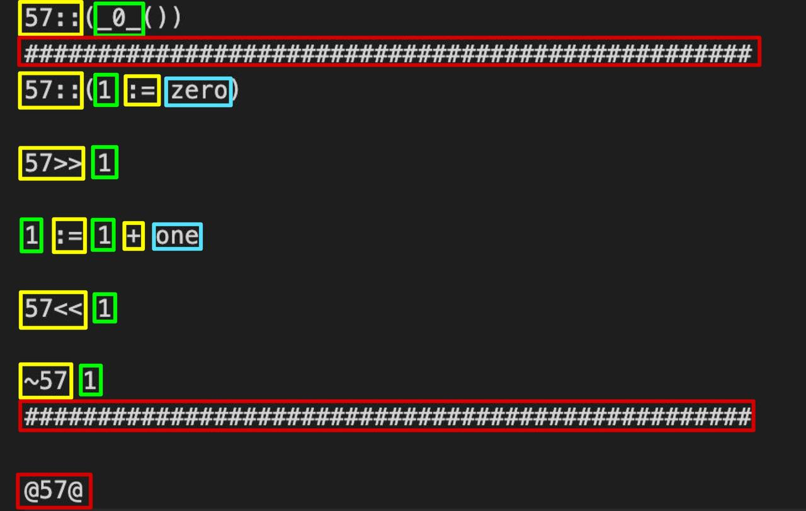
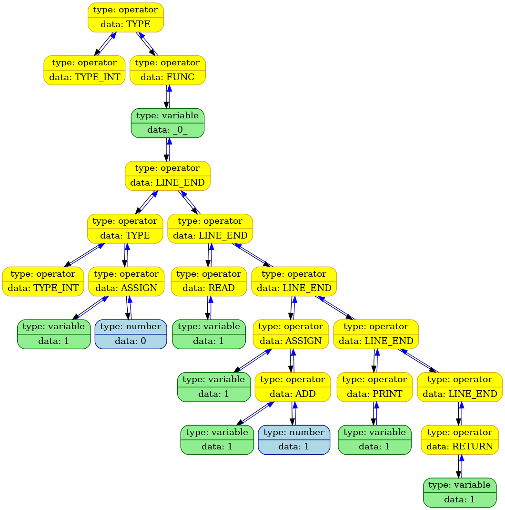
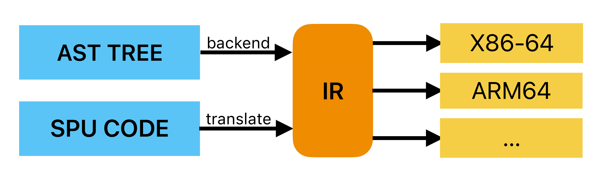
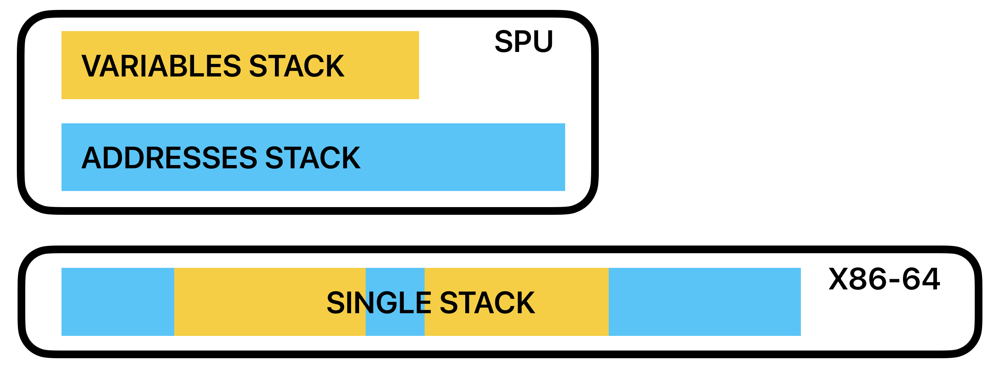
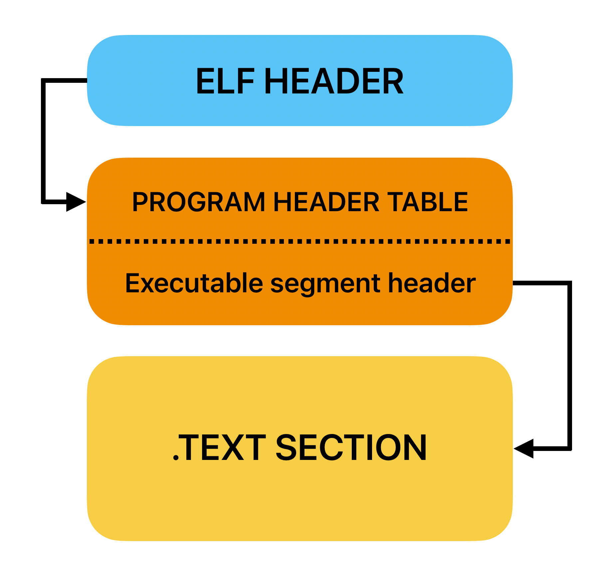
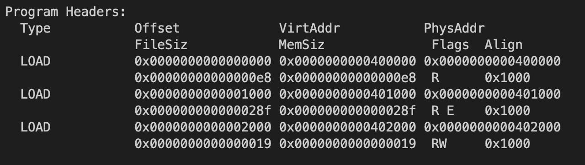
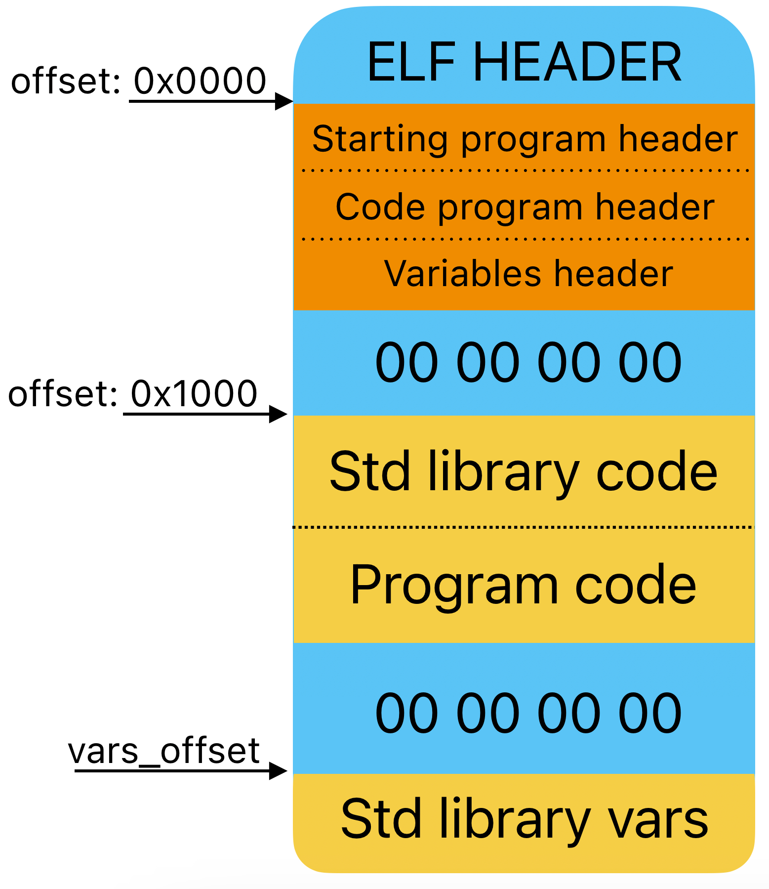

# 57Lang Programming Language and x86-64 Compiler


### Installation (Linux)

```bash
git clone https://github.com/worthlane/x86compiler_for_57Lang
cd x86_compiler_for_57Lang
make makedirs
make

chmod +x ./run.sh
```

### Usage

```bash
./run.sh <filename> <flags> ...
```

#### Available flags

```-fdump``` — generates log files during compilation.  
```-S``` — generates a NASM assembly file containing the compiled program.  
```-O0``` — disables compiler [optimizations](#ir-optimization).

# Contents

1. [Language](#language)
    1. [Description](#description)
    2. [Syntax](#language-syntax)
        1. [Numbers](#numbers)
        2. [Operations](#operations)
        3. [Keywords](#keywords)
    3. [Grammar](#grammar)
    4. [Compiler Pipeline](#compiler-pipeline)
        1. [Frontend](#frontend)
        2. [Middle-end](#middle-end)
        3. [Backend](#backend)
2. [Compiler](#compiler)
    1. [IR](#ir)
        1. [Why is it needed?](#why-is-it-needed)
        2. [Translation from IR](#translation-from-ir)
        3. [IR Optimization](#ir-optimization)
    2. [ELF Generation](#elf-generation)
        1. [Headers](#headers)
        2. [Standard Library](#standard-library)
    3. [Performance Comparison](#performance-comparison)

## Language

### Description

57Lang is a Turing-complete programming language.

### Language Syntax

The main features of the language are:

1. The language supports functions, recursion, loops, and conditional blocks.
2. All variables have the same type. Variables can store non-integer signed values, but only integer values can be assigned directly.
3. Every function must return a value.
4. Every program must contain a function named ```_0_```, which is equivalent to ```main``` in C.
5. The language supports local variables inside loops and conditional blocks. Global variables are currently not supported.

The syntax is somewhat similar to C, although there are significant differences between the two languages.

#### Numbers

One of the main ideas behind the language is to swap the roles of digits and letters compared to conventional programming languages. Therefore, all numeric literals are written using words.

```text
0 = zero
1 = one
2 = two
3 = three
4 = four
5 = five
6 = six
7 = seven
8 = eight
9 = nine
```

For example:

```text
57   = five_seven
179  = one_seven_nine
-228 = -two_two_eight
```

#### Operations

Arithmetic operations use standard notation:

```text
... * ... - multiplication
... / ... - division
... + ... - addition
... - ... - subtraction
```

#### Keywords

Since letters are used to represent numeric literals, keywords are represented using digits and special characters.

```text
57?    = if
1000_7 = while
:=     = assignment
$1#    = sine
57#    = square root
<0$    = cosine
57>>   = input
57<<   = output
57::   = type
~57    = return
@57@   = end
.57    = end of block
```

Variable names are also represented using numbers and special characters. Examples of valid variable names are ```3```, ```57_23```, and ```57$$@_&23321```.

The following example shows equivalent code in C and 57Lang.

C:

```C
int x = 0;
scanf("%d", &x);        // input
if (x == 1337)
{
  while (x)
  {
    x = x - 1;
  }
  printf("%d", x * 10); // output
}
```

57Lang:

```js
57::(1337 := zero)
57>> 1337               // input
57? (1337 == one_three_three_seven)
  1000_7 (1337)
    1337 := 1337 - one
  .57
  57<< 1337 * one_zero  // output
.57
```

Every program must end with the ```@57@``` token. This also leaves room for extending the language in the future to support multiple programs in a single source file.

Conditional and loop blocks begin immediately after their declaration and end when the ```.57``` operator is encountered.

A function is defined as follows:

```js
57::(name(57::(variable), 57::(variable)))
##################################################

// function body

~57 value // every function must return a value
##################################################
```

Function blocks are separated using sequences of ```#``` characters.

More code examples can be found in the [examples](examples) directory. It contains a factorial implementation and a program for solving quadratic equations.

#### Grammar

The parser is implemented using [recursive descent](https://en.wikipedia.org/wiki/Recursive_descent_parser). The source code is parsed according to the following grammar:

```text
Program          ::= DefFunc Break {DefFunc Break}* END
DefFunc          ::= Type NewFuncName L_BRACKET FuncVars R_BRACKET {LINE_END}* FUNC_WALL SubProgram FUNC_WALL
CallVars         ::= L_BRACKET Expr { [,] Expr }* R_BRACKET
CallFunc         ::= Name CallVars
FuncVars         ::= OneFuncVar { [,] OneFuncVar }*
OneFuncVar       ::= Type L_BRACKET Var R_BRACKET
SubProgram       ::= Block
WhileSection     ::= WHILE L_BRACKET Expression R_BRACKET {LINE_END}* Block BLOCK_END
IfSection        ::= IF    L_BRACKET Expression R_BRACKET {LINE_END}* Block BLOCK_END
Block            ::= {Line Break}*
Line             ::= {IfSection | WhileSection | Return | Assignment | Init }*
Init             ::= TYPE L_BRACKET InitialAssignment R_BRACKET
Assignment       ::= Name ASSIGN Expression
Return           ::= RETURN Expression
Expression       ::= AndOperand   { [OR] AndOperand }*
AndOperand       ::= Comparison   { [AND] Comparison }*
Comparison       ::= Summ         { [<=>] Summ }*
Summ             ::= Term         { [ADD SUB] Term }*
Term             ::= Degree       { [MUL DIV] Degree }*
Degree           ::= Trigonometry { [^] Trigonometry }*
Trigonometry     ::=              { [SIN COS] Brackets }*
Brackets         ::= L_BRACKET Expression R_BRACKET | Component
Component        ::= [+ -] (Name | Num | CallFunc)
Type             ::= TYPE
Break            ::= LINE_END
Name             ::= NAME
Num              ::= NUM
```

#### Notation

* ```Word``` — call the function ```Word```;
* ```WORD``` — consume the ```WORD``` token;
* ```{ A | B | C | ... }``` — one of the alternatives: ```A```, ```B```, ```C```, etc.;
* ```[WORD]``` — optional ```WORD``` token;
* ```A*``` — ```A``` repeated zero or more times.

## Compiler Pipeline

The compiler consists of three main stages:

1. [Frontend](#frontend) — processes the input source file and builds an abstract syntax tree.
2. [Middle-end](#middle-end) — optimizes the AST.
3. [Backend](#backend) — translates the AST into an executable binary for the x86-64 architecture.

### Frontend

The frontend can be divided into several stages:

* First, the lexer splits the source code into individual meaningful units, combining sequences of characters into lexemes, also called tokens. Tokens include variable names, operators, type declarations, and other language constructs.



* The parser then processes the tokens using a recursive descent algorithm and builds an [AST](https://en.wikipedia.org/wiki/Abstract_syntax_tree) representing the structure and operations of the program.



* The AST is stored in the ```assets``` directory. In addition to the tree itself, the file also contains the name of the input source file without its extension. This allows the output binary name to be passed between different stages of the compiler.

### Middle-end

During the second stage, the compiler traverses the AST and simplifies expressions whose result can be determined at compile time.

This avoids unnecessary calculations at runtime.

Examples of such optimizations:

```text
1 + 1  -> 2
0 * x  -> 0
1 * x  -> x
x / x  -> 1
```

### Backend

The backend is the final compilation stage.

It traverses the AST and translates it into machine instructions. In the previous version of the language, the AST was translated into instructions for a custom processor. In this version, the backend implements an x86-64 compiler that directly generates executable ELF files.

# Compiler

## Architecture

As described above, the backend must transform the AST into a representation that can later be translated into machine instructions.

The process consists of three stages:

1. Translate the AST into an array of IR instructions.
2. Perform several passes over the IR to compute and fill in additional information.
3. Translate the completed IR into x86-64 machine instructions.

### IR

[IR](https://en.wikipedia.org/wiki/Intermediate_representation) (Intermediate Representation) is an array of structures containing information about individual instructions.

Once fully constructed, the IR contains enough information to generate the corresponding machine-code instruction sequence for the target architecture.

In this compiler, the IR is represented as an array of ```instruction_t``` structures.

```C
struct instruction_t
{
    int address;               // instruction address

    InstructionCode code;      // instruction code

    bool   need_patch;         // does instruction need patch
    size_t refer_to;           // refer to other instruction

    ArgumentType type1;        // first argument type
    int          arg1;         // first argument value

    ArgumentType type2;        // second argument type
    int          arg2;         // second argument value
};
```

#### Why is it needed?

A natural question is why the compiler first translates the AST into IR instead of generating assembly instructions directly. There are at least two important reasons.

* First, IR is useful for encoding instructions that operate on addresses, such as ```jmp``` and ```call```. These instructions require a relative byte offset as an argument, which can only be calculated after the final linear sequence of instructions is known.

  When such an instruction is generated, ```need_patch``` is set to ```true```, while ```refer_to``` stores the index of the target instruction.

  After the complete IR has been generated and the addresses of all instructions have been calculated, another pass can fill in the missing offsets for every instruction where ```need_patch == true```.

  This allows all required address information to be calculated in $O(n)$ time.

* Second, the IR can be used as a common intermediate stage for translating not only from an AST, but also from another instruction set. For example, code for my custom [processor](https://github.com/worthlane/SPU_emulator) could be translated into this IR and then compiled for another architecture.

  This reduces the amount of architecture-specific translation code that needs to be implemented.



### Translation from IR

After generating the IR from the AST, the compiler must translate it into instructions for the target architecture. In this case, the target is an x86-64 ELF executable.

Since the IR consists of abstract instructions, each IR instruction must be mapped to one or more x86-64 instructions.

These translations are defined in [instructions.h](src/backend/compiler/instructions.h).

Code generation is used so that the same instruction definitions can produce either a ```.s``` file for NASM, generated when the ```-S``` flag is used, or machine code written directly into an ELF executable.

#### Translation Details

The custom processor used two stacks: one for arithmetic operations and another for return addresses. Variables were stored in RAM.

When translating to x86-64, only one stack is used. It would be possible to allocate a separate memory region and emulate a second stack, but instead all data is stored on the regular stack and accessed using offsets relative to ```rbp```.

This requires using a [stack frame](https://en.wikipedia.org/wiki/Call_stack#Structure).



Operations involving variables use ```XMM``` registers so that floating-point values can be stored and processed.

#### Standard Library

Some IR instructions do not have direct equivalents in the target instruction set. For these operations, the compiler uses a small standard library.

The [stdlib.s](std_lib/stdlib.s) file contains implementations of instructions such as ```in```, ```out```, and ```hlt```.

#### IR Optimization

Once the IR is fully generated, it can be optimized using linear passes that detect redundant instruction sequences.

One implemented optimization replaces consecutive ```push``` and ```pop``` instructions with matching arguments by two ```nop``` instructions.

In the IR representation, these ```nop``` instructions do not generate any machine code and therefore occupy zero bytes in the final executable.

### ELF Generation

Generating an ELF executable required implementing the necessary parts of the ELF file format.

References used during implementation:

* [skyfree](http://www.skyfree.org/linux/references/ELF_Format.pdf)
* [tchajed](https://github.com/tchajed/minimal-elf)
* [scratchpad](https://scratchpad.avikdas.com/elf-explanation/elf-explanation.html)
* [stackoverflow](https://stackoverflow.com/questions/76345246/trying-to-generate-the-smallest-elf-file-possible-in-c)

A minimal ELF executable consists of several parts:

1. ELF header, which contains general information about the executable.
2. Program headers, which describe regions of the program such as code and data.
3. Code and data themselves.



#### Headers

The required headers can be generated using the ```Elf64_Phdr``` and ```Elf64_Ehdr``` structures provided by ```elf.h```.

Since the compiler can already generate a NASM ```.s``` file, this file can be assembled separately and inspected using:

```bash
readelf --all <filename>
```

This makes it possible to determine the necessary ELF header fields and compare the manually generated executable with a valid ELF file.



The first program header remains unchanged regardless of the source program. Its ```memsiz``` depends on the number of program headers, which is fixed.

The second program header describes the code of the standard library together with the generated program code. Its ```memsiz``` is equal to the total number of bytes occupied by the standard library code and the generated code.

The third program header describes the variables used by the standard library. The size of this region is constant, while the data starts after the code section at an address aligned to ```0x1000```.

#### Standard Library

After generating the ELF headers, the standard library must be included in the binary.

The library is assembled with NASM in advance to produce a binary file. The headers described above are removed from this file, leaving only the standard library code and its data.

The final executable is then constructed in the following order:

1. Standard library code.
2. Generated program code.
3. Standard library data.



> [!WARNING]
> The offsets specified in the program headers must be preserved. Any unused space between sections must be filled with zero bytes until the required offset is reached.

## Performance Comparison

The compiler now produces a native executable ELF file.

To measure the performance difference, a program calculating the factorial of a number was executed $5 \cdot 10^6$ times.

Execution time was measured three times using the ```time``` command.

The results were compared with the previous implementation, where the program was executed using the custom [SPU emulator](https://github.com/worthlane/57Lang).

|        | $t_1$, s | $t_2$, s | $t_3$, s | $t_{avg}$, s |
|:------:|:--------:|:--------:|:--------:|:------------:|
| SPU    | $5.450$  | $5.020$  | $5.025$  | $5.2 \pm 0.3$ |
| x86-64 | $0.098$  | $0.096$  | $0.103$  | $0.100 \pm 0.005$ |

The native x86-64 version is approximately $50 \pm 5$ times faster than the previous emulator-based implementation.

In addition to the performance improvement, this also improves portability. The previous version required the custom SPU emulator to execute 57Lang programs, while the new compiler produces standalone x86-64 ELF executables.
